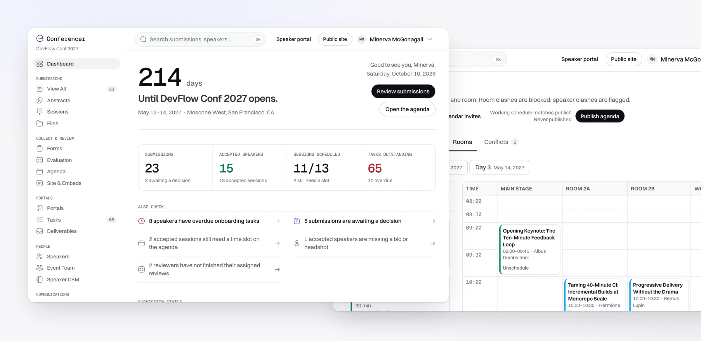
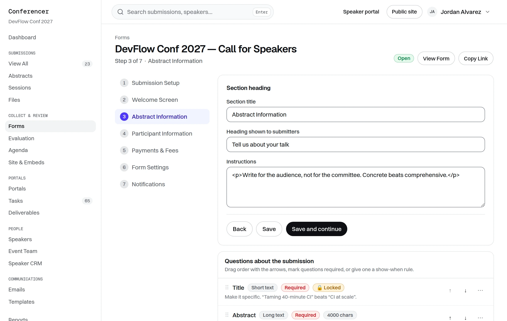
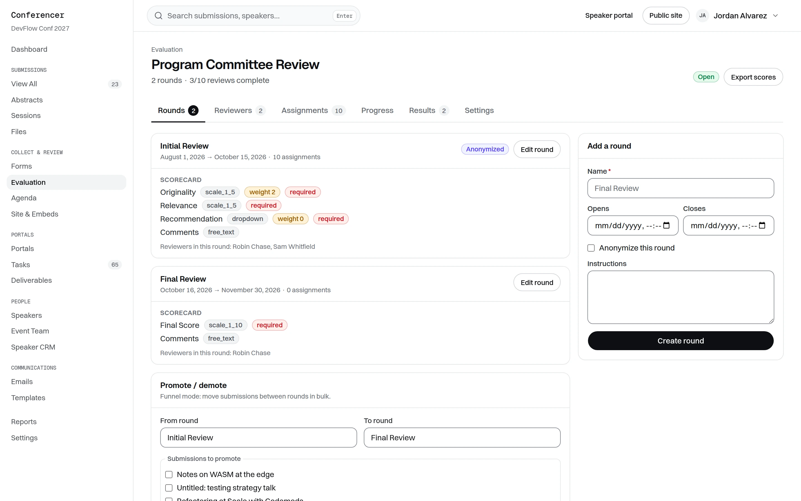
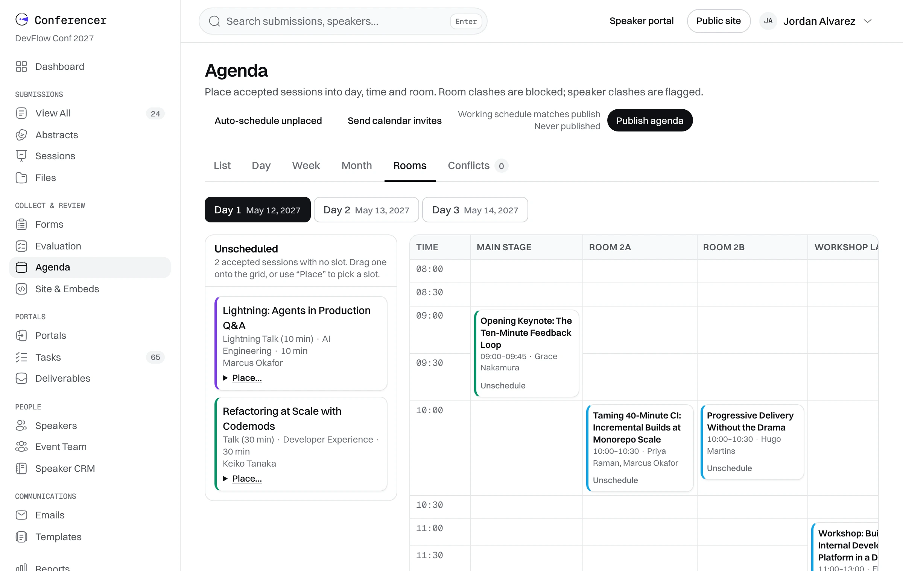
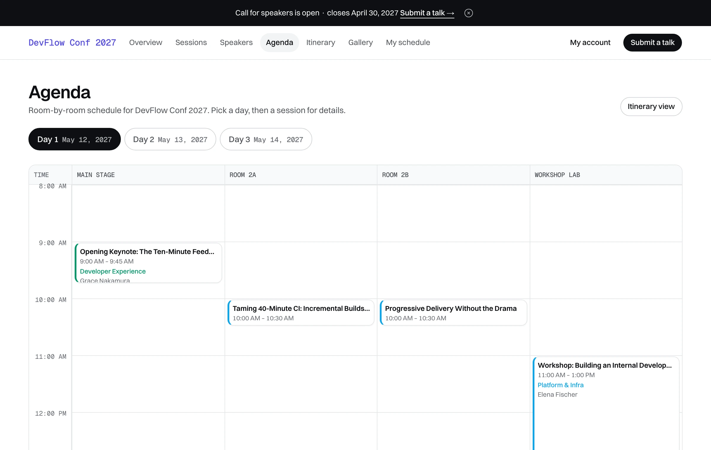

<h1 align="center">Conferencer</h1>

<p align="center">
  <strong>Open-source software for running a conference's speaker program.</strong><br>
  Call for speakers, committee review, speaker onboarding and the agenda, in one self-hosted app.
</p>

<p align="center">
  <a href="https://conferencer.cc/demo/organizer"><strong>Try the live demo</strong></a> ·
  <a href="#quick-start">Run it locally</a> ·
  <a href="#deploy">Deploy</a> ·
  <a href="docs/development.md">Developer docs</a>
</p>

<p align="center">
  <a href="LICENSE"></a>
  
  
  
</p>

<p align="center">
  
</p>

## What it is

Conferences that take talk proposals often pay for an event suite like Sessionboard, which
can run to five figures a year. Conferencer replaces the
**program** part of that: everything between "we're accepting talks" and "here's the
published schedule".

1. **Collect.** Build a call-for-speakers form with conditional questions. Speakers submit
   through a public wizard, no invite needed.
2. **Review.** A program committee scores submissions in rounds, blind if you want, with
   conflict-of-interest recusal and weighted scorecards.
3. **Decide.** Accept or decline individually or in bulk. Speakers get templated emails,
   and accepted ones get portal access and onboarding tasks automatically.
4. **Onboard.** Speakers upload bios, headshots and slides and complete tasks in their own
   portal, while you track who's missing what.
5. **Schedule.** Drag sessions onto a rooms-by-time grid. Room clashes are blocked, speaker
   double-bookings are flagged, and calendar invites go out on publish.
6. **Publish.** A public event site with sessions, speakers, the agenda and a personal
   schedule, plus embeddable widgets and JSON/iCal feeds.

It is one Next.js app with an embedded SQLite database. There is no database server,
no cloud account and no API key needed to run it, and production is one container with
one volume.

### A closer look

<table>
  <tr>
    <td width="50%" valign="top">
      
      <p><strong>Form builder.</strong> Seven-step CFP setup, 14 field types, show-when logic and routing by track.</p>
    </td>
    <td width="50%" valign="top">
      
      <p><strong>Committee review.</strong> Multi-round evaluation with scorecards, blind rounds, reviewer caps and live progress.</p>
    </td>
  </tr>
  <tr>
    <td width="50%" valign="top">
      
      <p><strong>Agenda builder.</strong> Drag-and-drop or click-to-place, with clash detection, auto-schedule and a publish diff.</p>
    </td>
    <td width="50%" valign="top">
      
      <p><strong>Public site.</strong> What attendees see, readable without logging in and exportable to their calendar.</p>
    </td>
  </tr>
</table>

<details>
<summary><strong>Full feature list</strong></summary>
<br>

| Area | What you get |
| --- | --- |
| **Call for speakers** | Seven-step form builder, 14 field types, required/locked flags, conditional show-when logic, track routing into a review round on arrival, close dates, per-person limits, drafts, custom success page, confirmation email |
| **Public submission** | Five-step wizard (Welcome → Account → Submission → Participants → Review) that anyone can complete without an invitation |
| **Submissions** | Status tabs with counts, inline and bulk status changes, column picker, saved views, filters, search across titles *and* speaker names, CSV export, change history with restore |
| **Review** | Multi-round evaluation plans, per-round reviewer pools and scorecards (1–3 / 1–5 / 1–10 / numeric / weighted dropdown / free text / file), blind rounds, conflict-of-interest recusal, auto-distribution with per-reviewer caps, live progress, weighted results, bulk reminders, CSV export |
| **Decisions** | Accept/decline individually or in bulk, templated emails with merge fields and preview, per-submission Notified flag. Accepting activates the speaker, grants portal access and assigns onboarding tasks |
| **Speakers** | Roster with search and filters, manual add, CSV import with column mapping, workflow status, logistics fields, portal invitations, bulk email with per-recipient preview, communications history |
| **Speaker portal** | Submissions, profile (bio, headshot upload, links) and tasks, strictly scoped to the signed-in speaker |
| **Tasks & files** | Action, file-request and form tasks, due dates, upload constraints, versioning, cross-role comments, deliverables matrix, bulk reminders, files library, ZIP export by session or speaker |
| **Agenda** | Rooms grid with drag-and-drop and click-to-assign, list/day/week/month/conflicts views, speaker double-booking warnings, blocked room clashes, auto-schedule, publish with a diff, `.ics` invites and per-speaker calendar feeds |
| **Public site** | Sessions, speakers, agenda grid, itinerary, speaker gallery, personal schedule with `.ics` export |
| **Embeds** | One `<script>` tag per widget, plus HTML, JSON, XML and iCal feeds filterable by track and format |
| **Comms** | Editable templates with merge fields and preview, an outbox recording every send, scheduled reminders |
| **API** | Bearer-token REST API at `/api/v1` with cursor pagination, `updated_since` and bulk endpoints, an OpenAPI 3 spec, and HMAC-signed outbound webhooks |
| **Dashboard** | Countdown, headline counters, "also check" nudges, analytics and a speaker-readiness table |
| **Speaker CRM** | Org-level directory across events, cross-event history, duplicate detection and merge, sourcing pipeline, saved segments |

</details>

## Try it

The fastest way to see it is the hosted demo. Each link signs you straight in as that role:

- **[Organizer](https://conferencer.cc/demo/organizer)**: dashboard, submissions, review setup, agenda
- **[Reviewer](https://conferencer.cc/demo/reviewer)**: only the submissions assigned to you
- **[Speaker](https://conferencer.cc/demo/speaker)**: your submissions, profile and tasks
- **[Public event site](https://conferencer.cc/e/devflow-conf-2027)**: what attendees see, no login

The demo is shared with everyone, so expect other people's edits.

## Quick start

You need **Node 22 or newer**. Nothing else: no Postgres, no Redis, no Docker.

```bash
git clone https://github.com/yazinsai/conferencer.git
cd conferencer
npm install
npm run seed     # creates the demo event, "DevFlow Conf 2027"
npm run dev      # → http://localhost:3000
```

Open [localhost:3000](http://localhost:3000) and use one of the demo accounts below. They
are also listed on the sign-in page, and `/demo/organizer`, `/demo/reviewer` and
`/demo/speaker` sign you in with one click.

| Role | Name | Email | Password |
| --- | --- | --- | --- |
| Organizer | Minerva McGonagall | `demo-organizer@example.com` | `SbekTest!2027-org` |
| Reviewer | Severus Snape | `demo-reviewer@example.com` | `SbekTest!2027-rev` |
| Speaker | Hermione Granger | `demo-speaker@example.com` | `SbekTest!2027-spk` |
| Speaker | Harry Potter | `demo-speaker2@example.com` | `SbekTest!2027-spk2` |

The demo event is fully populated: 23 submissions in every status, a CFP form with
conditional logic, two review rounds with scores, onboarding tasks, a three-day agenda and
an email outbox. All people are fictional.

Your data lives in `data/` (the SQLite database and uploads). Delete that folder, or run
`npm run seed:reset`, to start over.

### Where things are

| URL | What it is |
| --- | --- |
| `/admin` | Organizer workspace |
| `/review` | Reviewer queue |
| `/portal` | Speaker portal |
| `/e/devflow-conf-2027` | Public event site and submission form |
| `/crm` | Speaker CRM across events |
| `/api-docs` | REST API reference |

## Deploy

Conferencer ships as a single Docker container. Data lives in one volume mounted at `/data`.

```bash
cp .env.example .env     # then set SESSION_SECRET and APP_URL
docker compose up -d --build
docker compose exec app npm run seed   # optional: load the demo event
```

This works on any host that runs a container: a VPS, Fly.io, Render, Railway or Dokku.
The build needs no network access for fonts or assets, so it also works on locked-down
CI runners.

To send scheduled reminder emails, run `npm run cron` from the host's crontab, or point a
scheduler at `POST /api/cron` with `Authorization: Bearer $CRON_SECRET`.

### Configuration

Every variable is optional, and the app boots with none set. For local development, put
them in `.env.local`.

| Variable | What it does |
| --- | --- |
| `SESSION_SECRET` | Signs session cookies. **Always set this in production.** |
| `APP_URL` | Public URL, used in emails and calendar invites |
| `DATA_DIR` | Where the database and uploads live (default `./data`) |
| `RESEND_API_KEY` | Sends email through [Resend](https://resend.com) |
| `EMAIL_FROM` | From address for outgoing email |
| `CRON_SECRET` | Protects `POST /api/cron` |
| `OPENAI_API_KEY` / `OPENAI_MODEL` | Uses an LLM for submission triage |
| `AIRTABLE_API_KEY` / `AIRTABLE_BASE_ID` | Mirrors data to Airtable |

A missing key never breaks a feature. Without an email provider, every message still
lands in the in-app outbox, and without an OpenAI key, triage falls back to a local
rubric.

## How it's built

- **Next.js 16 App Router**, server-rendered throughout. Pages read the database and
  render in one pass, with no client-side data fetching.
- **SQLite through `better-sqlite3`**, plain SQL and no ORM. [`schema.sql`](schema.sql)
  is the whole schema.
- **shadcn/ui and Tailwind v4** on a documented design system ([`design.md`](design.md)).
- **One authorization chokepoint** (`src/lib/guards.ts`) that every page and server
  action calls.
- **An end-to-end smoke test** (`npm run smoke`) that walks the product as each role.

The architecture, conventions, recipes and invariants are in
**[docs/development.md](docs/development.md)**.

## Contributing

Issues and pull requests are welcome. See [CONTRIBUTING.md](CONTRIBUTING.md) for setup
and checks, and [SECURITY.md](SECURITY.md) to report a vulnerability privately.

## Licence

[MIT](LICENSE). Fork it, run it, never pay for it.
